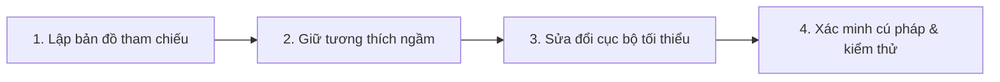

# Kỹ Năng Tái Cấu Trúc An Toàn Cho Tệp Mã Nguồn Lớn

Kỹ năng này giúp Agent thực hiện các thao tác sửa đổi, thêm hoặc bớt chức năng trên các file đơn khối lớn (như `patient_service.js` ~3.700 dòng, `index.html` ~1.900 dòng) một cách an toàn, nhanh chóng và không gây lỗi hồi quy.

---

## 1. Quy Trình 4 Bước Bắt Buộc



### Bước 1: Lập bản đồ tham chiếu (Scouting)
- Trước khi xóa hoặc đổi tên bất kỳ element DOM hay field dữ liệu nào, **bắt buộc chạy `grep_search`** trên toàn bộ workspace.
- Ghi nhận tất cả các nơi đang gọi element hoặc field đó (render table, render cards, modal save, modal open, local cache, print format, database sync).

### Bước 2: Giữ tương thích ngầm (Backward Compatibility)
- Nếu người dùng yêu cầu **bỏ một ô nhập trên UI**:
  - Không xóa bỏ hẳn element khỏi DOM nếu JS vẫn đọc nó. Hãy chuyển thành `<input type="hidden" id="...">`.
  - Trong logic JavaScript, luôn dùng Safe Navigation và fallback giá trị cũ:
    ```javascript
    const docVal = document.getElementById('editDoctorName')?.value?.trim() || existingPatient?.doctor_name || '';
    ```
- Không làm mất mát trường dữ liệu trong Supabase hay cache của người dùng.

### Bước 3: Sửa đổi cục bộ tối thiểu (Surgical Edits)
- **Không bao giờ ghi đè toàn bộ file lớn bằng `write_to_file`**.
- Dùng `replace_file_content` cho các đoạn chỉnh sửa đơn.
- Dùng `multi_replace_file_content` khi cần chỉnh sửa nhiều đoạn rời rạc trong cùng một file, chỉ định rõ `StartLine` và `EndLine` hẹp để đảm bảo chính xác tuyệt đối.

### Bước 4: Xác minh ngay lập tức (Immediate Verification)
- Sau khi sửa bất kỳ file `.js` nào, ngay lập tức chạy:
  ```powershell
  npm run lint
  # hoặc
  node -c <duong_dan_file.js>
  ```
- Nếu có lỗi cú pháp, sửa ngay trong lượt hiện tại, không chuyển giao trạng thái lỗi cho người dùng.
